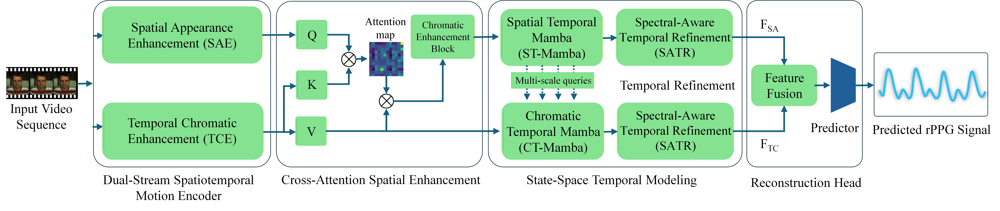
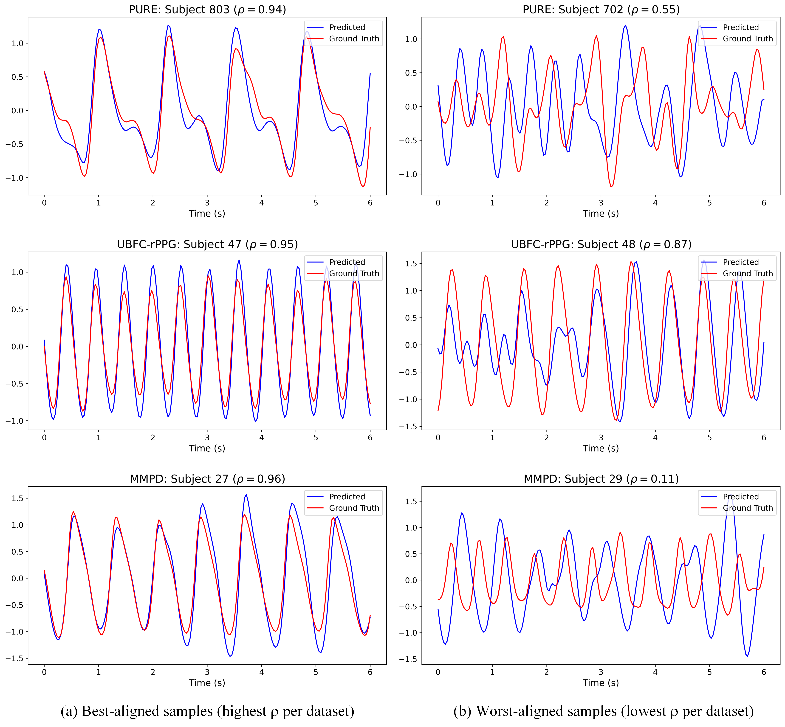
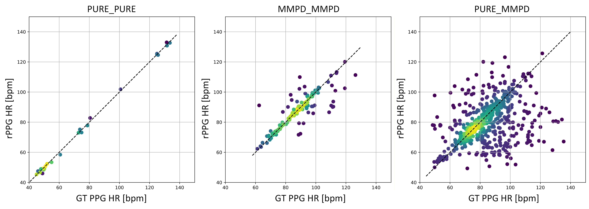

# SS-Mamba

Implementation of paper **SS-Mamba: Spatio-Spectral Cross-Attention Temporal Encoding for Accurate Remote Photoplethysmography**. This repository contains the model, training and evaluation pipeline, dataset loaders, and configuration files for intra-dataset and cross-dataset experiments.

## Overview

SS-Mamba estimates pulse signals from face video by combining spatial, spectral, and temporal modeling. The overall block diagram of the proposed framework is shown below.



## Results
### Quantitative Results
#### Intra-Dataset

| Dataset    | MAE ↓ | RMSE ↓| ρ (Pearson) ↑|
|------------|------|--------|--------------|
| PURE       | 0.24 | 0.36   | 1.00|
| UBFC-rPPG  | 0.45 | 0.76   | 1.00|
| MMPD       | 3.16 | 7.07   | 0.86|

#### Cross-Dataset

| Train → Test | MAE ↓ | RMSE ↓ | ρ (Pearson) ↑|
|--------------|------|--------|-----|
| PURE → MMPD  | 8.64 | 13.73  | 0.56|
| MMPD → PURE  | 6.91 | 16.17  | 0.72|

## Qualitative Results





## Pretrained Models

| Model | Dataset | Link |
|------|--------|------|
| SS-Mamba | PURE-intra      | [Download](pretrained/PURE_PURE_PURE_SSMamba_Epoch29.pth)  |
| SS-Mamba | UBFC-rPPG-intra | [Download](pretrained/UBFC_UBFC_UBFC_SSMamba_Epoch29.pth)  |
| SS-Mamba | MMPD-intra      | [Download](pretrained/MMPD_MMPD_SSMamba_Epoch28.pth)  |
| SS-Mamba | PURE-MMPD-cross | [Download](pretrained/PURE_MMPD_SSMamba_Epoch29.pth)  |
| SS-Mamba | MMPD-PURE-cross | [Download](pretrained/MMPD_PURE_SSMamba_Epoch29.pth)  |


## Evaluation Metrics
SS-Mamba model is evaluated on both Heart Rate estimation metrics and waveform-level signal quality metrics.

### Heart Rate Estimation Metrics
- MAE: Mean Absolute Error
- MAPE: Mean Absolute Percentage Error
- RMSE: Root Mean Square Error
- Pearson correlation (ρ)

### Waveform-level Signal Quality Metrics
- DTW: Dynamic Time Warping
- PSD: Power Spectral Density Correlation
- Pearson correlation (ρ)


## Repository Layout

- [main.py](main.py) - for training, testing, and inference
- [neural_methods/model/SSMamba.py](neural_methods/model/SSMamba.py) - SS-Mamba model implementation
- [configs/](configs/) - YAML configuration files for intra-dataset and cross-dataset experiments
- [dataset/](dataset/) - dataset loaders and preprocessing helpers
- [evaluation/](evaluation/) - metrics and post-processing utilities

## Installation

### Environment

```bash
conda create -n mamba python=3.9
conda activate mamba
pip install torch==2.0.0 torchvision==0.15.0 torchaudio==2.0.0 pytorch-cuda=11.8 -c pytorch -c nvidia
```

### Install packages

```bash
pip install -r setup/requirements.txt
```

### Install causal-conv1d

```bash
cd setup/causal-conv1d-main
python setup.py install
```

## Datasets
Update dataset paths in the [config](configs) files accordingly.

Supported datasets:

- [UBFC-rPPG](https://sites.google.com/view/ybenezeth/ubfcrppg)
    * S. Bobbia, R. Macwan, Y. Benezeth, A. Mansouri, J. Dubois, "Unsupervised skin tissue segmentation for remote photoplethysmography", Pattern Recognition Letters, 2017.

- [PURE](https://www.tu-ilmenau.de/universitaet/fakultaeten/fakultaet-informatik-und-automatisierung/profil/institute-und-fachgebiete/institut-fuer-technische-informatik-und-ingenieurinformatik/fachgebiet-neuroinformatik-und-kognitive-robotik/data-sets-code/pulse-rate-detection-dataset-pure)
    * Stricker, R., Müller, S., Gross, H.-M.Non-contact "Video-based Pulse Rate Measurement on a Mobile Service Robot"
    in: Proc. 23st IEEE Int. Symposium on Robot and Human Interactive Communication (Ro-Man 2014), Edinburgh, Scotland, UK, pp. 1056 - 1062, IEEE 2014

- [MMPD](https://github.com/McJackTang/MMPD_rPPG_dataset)
    * Jiankai Tang, Kequan Chen, Yuntao Wang, Yuanchun Shi, Shwetak Patel, Daniel McDuff, Xin Liu, "MMPD: Multi-Domain Mobile Video Physiology Dataset", IEEE EMBC, 2023

## Quick Start
### 1. Clone repo
```bash
git clone https://github.com/usmanraza121/SS-Mamba.git
cd SS-Mamba
```
### 2. Install dependencies
```bash
pip install -r setup/requirements.txt
```
### 3. Run training

### Intra-dataset training

Use one of the following intra-dataset configs:

```bash
python main.py --config_file configs/train_configs/intra/1PURE_SSMamba.yaml
```

```bash
python main.py --config_file configs/train_configs/intra/2UBFC-rPPG_SSMamba.yaml
```
```bash
python main.py --config_file configs/train_configs/intra/0MMPD_SSMamba.yaml
```

### Cross-dataset training

Use one of the following cross-dataset configs:

```bash
python main.py --config_file configs/train_configs/cross/PURE_MMPD_SSMamba.yaml
```
```bash
python main.py --config_file configs/train_configs/cross/MMPD_PURE_SSMamba.yaml
```

### Test only

Set `TOOLBOX_MODE: "only_test"` in your config and provide a valid checkpoint path in `INFERENCE.MODEL_PATH`.


Training logs are written under `runs/` by default.


## Citation

If you use this code in your research, please cite the SS-Mamba paper:

```bibtex
@article{ssmamba2026,
  title   = {SS-Mamba: Spatio-Spectral Cross-Attention Temporal Encoding for Accurate Remote Photoplethysmography},
  author  = {Muhammad Usman and Jacek Rumiński},
  journal = {under review},
  year    = {2026}
}
```

## Contact

For questions, collaboration, or data/model access requests:

- Muhammad Usman
- E-mail: [muhammad.usman1@pg.edu.pl](mailto:muhammad.usman1@pg.edu.pl)
- Gdansk University of Technology, FETI, Department of Biomedical Engineering, Gdansk, 80-233, Poland

## License
This project is licensed under the MIT License.
## Acknowledgements

Built upon:
- [rPPG-Toolbox](https://github.com/ubicomplab/rPPG-Toolbox) 
- [PhysMamba](https://github.com/Chaoqi31/PhysMamba)
