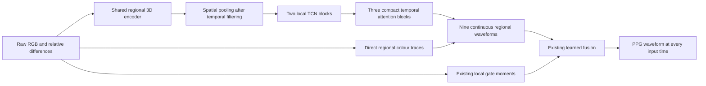

# RegionalSTAttention: a testable rPPG architecture design

Design/review date: 2026-11-26. Status: **integrated, untrained architecture experiment**. The project implementation is now opt-in through main.py, the shared trainer and dedicated configurations. Functional training/checkpoint/audit checks passed; physiological data training has not been run. Supplied reference repositories remain unchanged. See [the runnable experiment instructions](../experiments/2026-11-26_regional_st_run.md).

## Recommended first model

Use joint local spatial/temporal extraction before pooling, followed by short temporal filtering and compact full-clip attention. Preserve regional waveform decoding and the existing fusion/loss interface. The research objective is to recover the correct pulse under competing motion/illumination rhythms across HR ranges; overall MAE alone is insufficient.

Attention operates on time **within each region**, not across the nine regions. That preserves the candidate-isolation question and region-mask semantics; spatial cross-region interaction is a later factor. No text input, pretrained DINO, hard codebook, generated sinusoidal carrier, FFT postprocessor or test-time adaptation is in the first prototype.

## Why this targets the observed problem

The current model pools per-frame2D features before any learned temporal filtering, with a61-frame convolutional TCN receptive field. It can learn within PURE, so these are limitations to test, not established causes. DINO affects only the gate and has not shown a decisive benefit. Exp1 increases source missing dominant candidates27→40;32/40 retain reference-near secondary peaks, while39 lack a correct dominant candidate at every checked processing stage. This motivates retaining weak alternatives during extraction. Secondary peaks are not proof of physiological recovery, and a more capable model can still choose nuisance.

## Exact first prototype

Input uses the current cached Raw RGB [B,160,3,128,128],30Hz and standardized PPG labels. RawRGB is divided by255 once. Relative differences use the existing formula `(x_t-x_prev)/(x_t+x_prev+1e-3)` with the first frame repeated. A fixed3x3 grid yields nine crops; each is resampled to12x12 exactly as in the baseline. Higher24x24 spatial resolution is a separate trial with a correspondingly resized baseline, not an unreported change.

| Stage | Operation | Tensor shape |
|---|---|---|
| Regional input | RGB + relative differences, independent crops | [B*9,6,T,12,12] |
| Stem1 | Conv3D6→16, kernel3, stride(1,2,2), replicate pad; GELU | [B*9,16,T,6,6] |
| Stem2 | Conv3D16→24, kernel3, stride(1,2,2), replicate pad; GELU | [B*9,24,T,3,3] |
| Local refinement | Depthwise3D24, kernel3; GELU; pointwise24→24; GELU | [B*9,24,T,3,3] |
| Delayed pooling | Spatial mean after the local temporal filters | [B,9,T,24] |
| Trace merge | Append raw/difference6-channel means; existing temporal centering and30→48 projection | [B*9,48,T] |
| Local TCN | Existing two-convolution residual blocks, dilations1,2 | [B*9,48,T] |
| Global temporal mixer | Three pre-norm attention blocks,4heads, FFN48→96→48 | [B*9,48,T] |
| Regional head | Existing48→1 convolution + learned direct trace skip; center DC only | [B,9,T] |
| Gate/fusion | Existing quality head and softmax weights | [B,T] plus regional diagnostics |

The3D stem has a7-frame local temporal span before pooling. There is no temporal stride or temporal upsampling anywhere in this prototype. Attention sees all observed160 frames; it does not create a longer observation. At45 bpm the existing5.33s clip contains only about four cycles. Increasing clip duration requires real contiguous data and remains a separate experiment.

The attention blocks use channel LayerNorm, standard dot-product self-attention with no attention dropout, and time-shared channel dropout after attention/FFN. No absolute positional or cardiac-phase generator is added. Temporal order is encoded by the preceding local3D and TCN filters; absence of an absolute position vector does not prove rate invariance. The prototype is offline/noncausal. It is a compact task-trained Transformer component, not an image-pretrained ViT.

The returned auxiliary contract is unchanged: waveform[B,T], regional_waveforms[B,9,T], region_weights[B,9,T], quality_logits[B,9,T], valid_regions[B,9]. The fused waveform is the explicit weighted sum. No output variance normalization is introduced. The inherited self.receptive_field describes the local TCN convolutional span, not attention's global support; the separate temporal_support metadata states the distinction.

## Controlled architecture comparisons

Parameter counts below are measured by constructing the actual models; they are not estimates.

| Variant | Trainable parameters | Purpose |
|---|---:|---|
| A0: current2D +4TCN | 62,800 | Existing no-augmentation baseline |
| A1: same2D +6TCN | 91,024 | Longer-context/capacity control |
| A2: new local3D +6TCN | 100,936 | Joint local spatiotemporal extraction |
| A3: new local3D +2TCN +3attention | 101,368 | Preferred first candidate |

A2/A3 differ by432 parameters, about.43%; this is a useful comparison of temporal mixers at similar capacity. A0/A1 intentionally differ in capacity as well as temporal span and should not be called perfectly parameter-matched. Six TCN blocks have a nominal253-frame span including padding; outputs near a clip boundary do not all see every real frame. A3 has full-window attention at all positions. Keep this boundary-context difference explicit.

All four initially retain the same160-frame cache,30Hz,12x12 regional resampling, nine heads, fusion, loss weights,40epochs, batch16, peakLR1e-4, source split, checkpoint rule and evaluator. Rate augmentation is disabled. Use the same data order/initial seed policy, record settings, then matched repeated seeds for confirmation. The prototype functional script initializes variants for checks only; its sequential random draws are not a matched training experiment.

First screen A1 versus A2 on source validation to test the local encoder, then A2 versus A3 to test attention. Continue A3 only if it improves relevant source behavior without simply collapsing high HR. A full research comparison can include a general rPPG backbone such as PhysNet/FactorizePhys under matched data/evaluation; do not compare original-paper scores directly.

## Role of Mamba

An offline bidirectional Mamba temporal replacement is a planned alternative on the **same local3D features**, not an extra module stacked after attention. Specify actual selective-state implementation, forward/backward alignment, state size, reset policy and GPU dependencies; match capacity and context as closely as practical. Never substitute a GRU or generic recurrence and call it Mamba. The current SSMamba file imports custom SA/CA_Mamba2 components, so it cannot be assumed a portable drop-in.

At T160, small temporal attention is a reasonable first candidate because full-window interactions are inexpensive relative to all-pixel attention. Linear asymptotic complexity alone does not establish Mamba speed or accuracy for this short window. If real longer-context sequences become useful, remeasure both approaches at the longer duration. Neither backend was selected using new PURE test measurements.

## Candidate contribution: preserving pulse during spatial compensation

The first prototype is an established-component baseline, **not the unique contribution**. A more focused next hypothesis is spatial compensation that improves motion robustness without erasing weak pulse fluctuations. CodePhys already uses deformable convolutions, so adding that operator or its name is insufficient.

Proposed mechanism for a later experiment:

1. Predict bounded spatial offsets from video-derived geometric/motion descriptors, rather than treating the strongest periodic feature as pulse. These descriptors are nuisance cues, not independently certified pulse-free signals.
2. Sample features on the same frame times, with shared spatial locations across channels; no temporal offsets. Initialize offset weights and biases to zero. Specify whether modulation is absent or initialized to match the regular-grid operator.
3. Penalize excessive displacement and unjustified temporal jitter, while testing abrupt real motion so smoothness does not prevent tracking. Boundaries/invalid regions must remain explicit.
4. Measure the sampling module's pulse transfer on controlled weak colour modulation: frequency, gain and phase, alongside motion/illumination disturbances. A constant image and offset smoothness alone cannot certify pulse preservation.
5. Compare ordinary convolution, unconstrained spatial deformation and the constrained mechanism with matched capacity. Evaluate pulse/no-pulse controls, nuisance near the pulse frequency and overlapping-frequency cases. When nuisance and pulse are indistinguishable from RGB, confidence cannot create missing information.

For a paper claim, the exact conditioning/constraint must be distinguished from existing motion compensation, deformable rPPG, spectral attention, nuisance disentanglement and augmentation-consistency methods. A wider novelty search and controlled evidence are still required. If the constrained mechanism does not improve weak-pulse retention over the matched alternatives, reject this contribution hypothesis rather than rename the combination.

## PPG guidance and losses

CodePhys motivates a later continuous source-training-only PPG teacher: first show its reference autoencoder retains the source rate range and morphology, then compare video learning with/without latent distillation. Specify whether it is frozen or jointly trained. Remove it at inference. Compare against a decoder of matched capacity and, if useful, a discrete codebook control. A plausible prior can still produce the wrong rate.

Do not add this teacher, a new waveform loss and a new augmentation policy in A1–A3. The existing raw MSE/correlation/spectral/regional/quality objective remains the initial comparator. No GT-derived circular alignment, lag/peak selection or polarity optimization enters primary evaluation. Existing PURE timestamp/index interpolation differences remain a separate preprocessing issue; model changes do not establish waveform timing correctness or absolute physiological amplitude calibration.

PhysRAP-style target adaptation is also separate. Current wrong peaks can be consistently wrong across augmentations, so pseudo-label agreement is not independent physiological evidence. Any future CTTA result needs pre/post-adaptation scores, ordering/reset policy and an explicit source-only comparator.

## Validation completed and still required

The CPU functional checks passed for the four instantiated variants: finite output and gradients through the existing loss, variableT128/160/161, full128-square input, exact weighted fusion, masked-region isolation, batch isolation and static-input zero response. Direct temporal-module perturbation confirms global attention dependencies without using waveform mean-centering as a false global-context test. Static output max is approximately3.6e-15 for A3. These checks establish graph/contract behavior only; they do not measure physiological accuracy.

No foreign training code was executed; no model was trained, pretrained weights loaded or GPU throughput benchmark claimed. JSON timing includes checks and is not a speed ranking. The original isolated prototype is preserved as a design artifact. Its integrated implementation is now neural_methods/model/regional_st_attention.py, selected by MODEL.NAME: RegionalSTAttention, with strict model-name/argument checkpoint validation and shared preflight/audit construction. See the run instructions for exact configs and commands.

After training, inspect source validation recording MAE/RMSE, signed waveform correlation, bias, HR bins, subject variation, dominant-candidate availability before/after filtering, fundamental/second-harmonic power and learned/uniform fusion. Retain all failures. A gain that merely moves predictions toward an average HR is insufficient. Report matched repeated seeds, actual hardware memory/throughput and a fresh confirmatory dataset/split because PURE results have already guided development.

## Artifacts and source trail

- [Prototype](../../../artifacts/architecture_design_20261126/regional_st_attention.py)
- [Functional check script](../../../artifacts/architecture_design_20261126/check_prototype.py)
- [Measured parameter counts and checks](../../../artifacts/architecture_design_20261126/prototype_checks.json)
- [Source fingerprints and pinned upstream metadata](../../../artifacts/architecture_design_20261126/source_review_manifest.json)
- [Detailed model-code review](../../../.agents/skills/rppg-research/references/architecture-code-review-20261126.md)
- Primary mechanism sources: [ViT](https://arxiv.org/abs/2010.11929), [Mamba](https://arxiv.org/abs/2312.00752), [DCNv2](https://arxiv.org/abs/1811.11168), [PhysRAP](https://arxiv.org/abs/2510.01282).
