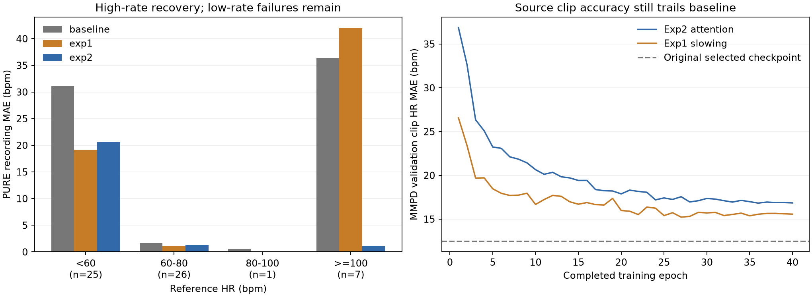
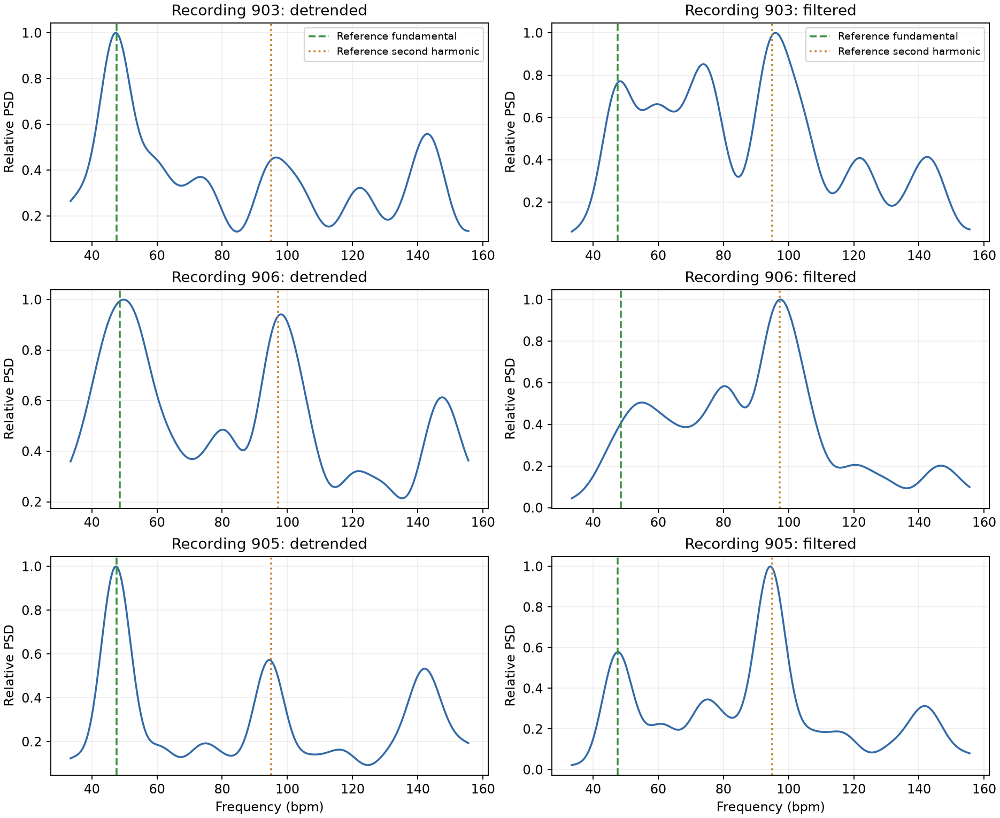

# Exp2 RegionalSTAttention: improved HR recovery, unresolved timing and low-rate errors

Reviewed 2026-11-26. Inputs: `Exp_data/exp2/{training.log,regional_history.jsonl,regional_waveforms.pt}`. No training code, loss, labels, cached data or primary evaluator was changed during this review. A reproducible artifact-analysis script and derived tables/figures are saved directly in `rPPG_VLM/` for the user's GitHub workflow.

**Follow-up source audit completed:** The [full MMPD comparison](2026-11-26_exp2_mmpd_audit.md) now shows MAE6.8709bpm versus original8.5660. Current filtering helps MMPD overall, unlike the PURE sensitivity result. The pending-audit statements below describe the earlier review snapshot. The matched3D–TCN control remains the next training comparison.

## Main result

Exp2 is the strongest aggregate PURE result so far: MAE is **9.4464 bpm**, a48.3% reduction from the original no-DINO model and30.5% from Exp1. The gain is uneven. High-rate HR estimation improves substantially; low-rate failures and weak directly aligned waveform agreement remain. The architecture is a promising candidate, not yet a confirmed generalization improvement or an isolated attention contribution.

| Full PURE test,59 recordings | Original no-DINO | Exp1 slowing | Exp2 new architecture |
|---|---:|---:|---:|
| MAE (bpm) | 18.2611 | 13.5837 | 9.4464 |
| RMSE (bpm) | 26.1051 | 22.8694 | 18.5096 |
| MAPE (%) | 30.6074 | 20.9427 | 18.7550 |
| HR Pearson | .0843 | .2679 | .7227 |
| Within5 bpm | 27/59 | 35/59 | 43/59 |
| Errors over10 bpm | 31 | 22 | 14 |
| Errors over20 bpm | 25 | 18 | 12 |

Legacy printed SNR improves -3.368→-1.965→.783dB. SNR uses the historical evaluator definition; do not compare it directly with the audit's separate power-SNR scores. The printed RMSE +/- formula has squared-error units and is not treated as a valid RMSE uncertainty interval. No subject-independent significance claim is made.

## Rate and subject behavior

| Reference HR (bpm) | Recordings | Original MAE | Exp1 MAE | Exp2 MAE |
|---|---:|---:|---:|---:|
| <60 | 25 | 31.1071 | 19.1611 | 20.6085 |
| 60–80 | 26 | 1.7032 | 1.1009 | 1.3294 |
| 80–100 | 1 | .5401 | 0 | 0 |
| >=100 | 7 | 36.4151 | 41.9699 | 1.0801 |

All seven high-rate cases are within5bpm, including six recordings from subject07 at approximately125–134bpm. Those seven recordings represent only two people, so this is not broad high-HR population validation. The improvement from Exp1 is driven by high-rate recovery; low-rate mean error is1.45bpm worse than Exp1. Against the original baseline, both low and high-rate aggregate errors improve. Exp2's positive bias is8.476bpm: remaining low-rate overestimation is substantial.

Subject05 MAE29.4329 and subject09 MAE44.5545 account for79.65% of all absolute error across59 recordings. Subject10 MAE is.6301; subject07 is1.2601. Exact matched12 comparison on subjects09/10 actually worsens: original20.7021, Exp117.1017, Exp222.5923. Do not call the new architecture uniformly better on subjects or silently replace that difficult subset with the full59 average.



## Run verification and comparison limits

The run is `runs/RegionalSTAttention_20261126_093244`, with101,368 trainable parameters. It completed40 epochs and selected/loaded zero-based epoch39 by MMPD source-validation loss from:

`runs/RegionalSTAttention_20261126_093244/checkpoints/MMPD_PURE_RegionalSTAttention_best.pth`.

Saved tensor metadata confirms the attention backend, spatial size12, hidden48, grid3, context32, dropout.1, learned fusion, Raw reconstruction and standardized labels. Config settings match the original for input paths, source/test datasets, data/splits, loss, schedule, batch16, peakLR1e-4 and checkpoint policy. Expected differences are architecture/family, model and run names, new settings block, and an explicitly disabled rate-augmentation block. Data counts remain5709 training,1507 validation and750 test clips. The static log heading says PURE_PURE, but the resolved configuration and loader paths establish **MMPD training/validation and PURE testing**; the heading is not protocol evidence.

All750 reference clips in Exp2 are exactly equal, tensor by tensor, to Exp1;59 recordings contain120,000 saved frames. All saved fused estimates reproduce the final reported HR/MAE under the existing diagnostic pipeline. Reference arrays for the historical12 recordings also exactly match the original baseline audit. Full59 original pairing remains based on identical reference-HR vectors and consistent evaluation order; original saved references/IDs are independently verified only for12. The trained checkpoint binary and full server cache were not supplied for local rehashing.

Training-log SHA256: `8556f7d431c4e3f615b6d81dc49b99cb8ab8571f8ea6523e84d47af1c946946a`. Other artifact fingerprints and exact resolved-config differences are in the numeric summary. One run per architecture cannot isolate effects of attention, local3D filtering, receptive field or increased capacity.

## Source-validation learning remains a concern

| Selected-checkpoint MMPD validation CLIP measure | Original epoch37 | Exp1 epoch39 | Exp2 epoch39 |
|---|---:|---:|---:|
| Loss | 1.3192 | 1.3731 | 1.3686 |
| Clip HR MAE (bpm) | 12.4730 | 15.5679 | 16.8535 |
| Mean waveform correlation | .2885 | .2710 | .2756 |
| Raw MSE | .9868 | .9911 | .9370 |
| Prediction standard deviation | .0702 | .0648 | .2637 |

Exp2's lower MSE and higher output amplitude do not imply improved HR or phase. Validation correlation stays below the original and clip HR MAE is worse. Early undefined-HR predictions disappear by the later epochs; training remains finite and validation loss generally decreases. Best-at-last does not establish that simply training longer will solve the remaining failures, especially with the one-cycle LR already near4e-10.

**Full-record MMPD validation for Exp2 is still missing.** Never compare its16.85 clip score directly with the original8.566 recording-level audit. MMPD validation already selected the checkpoint, so even the forthcoming audit is source-validation diagnosis, not a new independent source-test score.

## Regional extraction and fusion

The saved waveforms are sufficient to evaluate PURE regional controls locally; no additional server PURE audit is needed.

- Learned/uniform MAE is9.4464/10.0871bpm for the same candidates.
- 49/59 recordings have a processed regional dominant peak within5bpm, versus37/59 for Exp1.
- Reference-selected best-region MAE is2.5813bpm, versus9.3914 in Exp1. This is a GT-assisted oracle diagnostic, not deployable accuracy.
- Of14 fused errors over10bpm,5 retain a correct processed dominant candidate and9 do not. Eight of the ten missing-candidate recordings have a reference-near peak among a region's top3 peaks. Secondary-peak selection uses GT and does not establish recovered physiology.
- Seven learned estimates are near double the reference. No near-half estimates occur. There are69/531 regional second-to-fundamental band-power ratios above1; those powers are measured on detrended, un-bandpassed signals around reference-derived bands.

The combination of better uniform/oracle results and candidate availability supports an extractor improvement, especially at high rates. However, candidate availability depends strongly on preprocessing, and failures are an interaction among extraction, fusion and filtering. Do not repeat the earlier missing-candidate diagnosis as if raw pulse were necessarily absent.

## Substantial filter sensitivity: keep the primary score unchanged

Secondary analyses retain the **same current-protocol reference HR and fixed45–150bpm search**, changing only prediction preprocessing. Raw means DC removal; detrended uses the existing Tarvainen operation; filtered adds the existing.75–2.5Hz bandpass. No new cutoff or per-record peak rule was tuned.

| Prediction processing, diagnostic only | Exp1 MAE | Exp2 MAE | Exp2 within5 | Exp2 correct regional candidate |
|---|---:|---:|---:|---:|
| Raw, DC removed | 10.1695 | 4.4760 | 51/59 | 57/59 |
| Detrended without bandpass | 10.0322 | 4.6591 | 51/59 | 56/59 |
| Current filtered pipeline | 13.5837 | 9.4464 | 43/59 | 49/59 |

**9.4464 remains the primary protocol-comparable Exp2 result.** The4.476/4.659 figures are post-hoc sensitivity diagnostics, not new benchmark scores or justification for changing the evaluator on PURE.

Eight recordings are correct within5bpm when detrended but become errors over10 after the bandpass:903,906,905,901,801,501,904,506. For example903's detrended peak is47.52bpm, while filtering promotes96.13; the second/fundamental band-power ratio rises.472→1.332. Recording905 shifts47.52→94.51 with ratio.584→1.741. This repeats the previously identified low-edge/harmonic mechanism across more outputs. It explains a substantial part of the remaining error but not all failures: subject09 detrended MAE is still14.85bpm, and several competing rhythms remain.

Nine recordings lose a correct dominant regional candidate after filtering; two gain one. Every recording has a correct dominant regional candidate at **some** processing stage, which is a retrospective GT-dependent diagnostic and not a common inference policy. Keep all failures in the score. A protocol revision needs validation-based criteria, matched application to every comparator, and fresh confirmatory data; no reference-based half-rate correction, record exclusion or best-stage selection should be deployed.



## HR frequency is not directly aligned PPG waveform fidelity

Processed mean signed waveform correlation is only.00355. This is not merely cancellation between positive and negative cases: mean absolute unshifted correlation is.1416. Even among the43 correct-HR recordings, signed/absolute unshifted means are.0274/.1493. Thirty-two recordings have negative signed correlation.

Allowing a reference-selected lag within±1s and polarity improves mean absolute correlation to.5523, or.6347 in the correct-HR subset. Those are GT-assisted alignment diagnostics; a one-second window can align a large fraction or a whole pulse cycle and does not establish a fixed physical offset, correct morphology, or a deployable phase correction. The known PURE timestamp-versus-index interpolation issue remains a separate unresolved preprocessing factor. Do not automatically shift/invert predictions or change labels. HRV, calibrated amplitude and reliable waveform morphology are not established by the HR gain.

## Next experiments

First obtain the missing full MMPD validation audit for the new checkpoint:

```bash
python tools/audit_regional_dino.py \
  --config configs/train_configs/ablations/regional_st_attention.yaml \
  --checkpoint runs/RegionalSTAttention_20261126_093244/checkpoints/MMPD_PURE_RegionalSTAttention_best.pth \
  --split valid \
  --save-waveforms \
  --output diagnostics/mmpd_exp2_attention_full
```

This compares source recordings against the original8.566bpm and Exp111.424bpm audits. Saved signals allow the same raw/detrended/filtered mechanism check. Do not rerun Exp2 training or a duplicate PURE audit.

The next training comparison is the already prepared, nearly parameter-matched3D–TCN control:

```bash
python main.py --config_file configs/train_configs/ablations/regional_st_tcn.yaml
```

It retains the same3D extractor, loss, schedule, split and no-augmentation policy, with100,936 rather than101,368 parameters. It tests whether the temporal attention choice helps beyond the shared extractor and comparable capacity. It can run while the source audit finishes. Do not add Mamba, deformation, a teacher, stronger augmentation or a new decoder simultaneously. Preserve the common primary evaluator and fixed secondary diagnostics for both models.

If an explicit preprocessing follow-up becomes necessary, use the existing validation-protocol tool with the new checkpoint and locked criteria; do not select a cutoff from these PURE test cases. The full-MMPD audit, TCN attribution and waveform timing remain the priorities. Confirmatory claims require repeated matched seeds and untouched data because PURE has already informed development.

## Reproducibility

The analysis is implemented in [review_exp2_results.py](../../tools/review_exp2_results.py), run from the repository with `python tools/review_exp2_results.py`. It reads the supplied workspace artifacts and writes [summary/provenance](results/exp2_20261126/summary.json), [recording metrics](results/exp2_20261126/model_recordings.csv), [regional metrics](results/exp2_20261126/regional_candidates.csv), [matched twelve](results/exp2_20261126/matched12_recordings.csv), [subjects](results/exp2_20261126/subject_metrics.csv), and [fixed-reference spectral sensitivity](results/exp2_20261126/exp1_exp2_processing_sensitivity.csv). Reference-selected quantities are explicitly diagnostic; the production model, trainer and evaluator remain unchanged.
