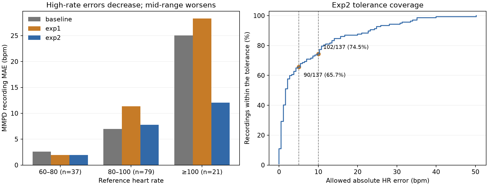

# Exp2 full MMPD validation: overall source improvement confirmed

Reviewed 2026-11-26. Input: `Exp_data/exp2/mmpd_exp2_attention_full/`, compared with `mmpd_no_dino_full/` and `mmpd_exp1_rate_aug_full/`. This review adds analysis and documentation directly in the GitHub-synced repository; it does not alter the training model, labels or evaluation protocol.

## Result

Exp2 improves whole-record MMPD validation MAE from **8.5660 to 6.8709 bpm (19.8%)**, together with the previously observed PURE aggregate improvement. This differs from Exp1's source/target trade-off. The gains remain uneven, and attention's contribution is not isolated from the new 3D extractor, broader temporal interactions and increased capacity.

| MMPD validation, 137 recordings | Original no-DINO | Exp1 slowing | Exp2 attention |
|---|---:|---:|---:|
| MAE (bpm) | 8.5660 | 11.4239 | 6.8709 |
| RMSE (bpm) | 13.5393 | 17.0337 | 12.1262 |
| Median absolute error (bpm) | 3.7804 | 5.4005 | 1.6202 |
| HR Pearson | .4981 | .3306 | .6270 |
| Within 5 bpm | 83/137 | 68/137 | 90/137 |
| Within 10 bpm | 94/137 | 80/137 | 102/137 |
| Errors over 20 bpm | 22 | 32 | 17 |
| Mean signed waveform correlation | .3565 | .3409 | .3812 |
| Uniform fusion MAE | 9.3228 | 11.5501 | 7.7579 |
| GT-selected regional oracle MAE, diagnostic only | 4.2455 | 5.6686 | 3.2522 |

The original source-validation clip diagnostic was 12.47 bpm and Exp2's was 16.85 bpm. The present recording-level comparison supersedes the concern that the worse clip score necessarily implies worse whole-record HR estimation. Clip and whole-record diagnostics use different windows, reconstruction and HR estimators; neither should be silently substituted for the other. All primary tables here use the same full-record protocol.

## What “within 5 bpm” and “within 10 bpm” mean

For each recording, compute `absolute_error = abs(estimated_HR - reference_HR)` in beats per minute.

- Within 5 bpm means absolute error **at most 5**.
- Within 10 bpm means absolute error **at most 10**.
- The counts are cumulative: every within-5 recording also counts within-10.

If reference HR is 80 bpm, predictions from 75 to 85 inclusive meet the 5-bpm tolerance; 70 to 90 inclusive meet the 10-bpm tolerance. A prediction of 87 has error 7, so it meets only the second tolerance. A prediction of 92 has error 12 and meets neither.

Here, **90/137 = 65.7%** of recording-level HR estimates are within 5 bpm and **102/137 = 74.5%** are within 10 bpm. Twelve recordings have error greater than 5 but at most 10; 35 exceed 10. These counts concern the HR derived from each complete reconstructed recording, not individual frames, beat-detection accuracy or waveform morphology. They are neither percentage errors nor confidence intervals, and they are unrelated to the historical `+/-` uncertainty printed beside MAE/RMSE. MAE 6.87 does not mean that every recording's error is at most 6.87.

## Matched population and provenance

Training and audited file-list hashes, source/audited subject lists and evaluation protocol match. Coverage and reference-check CSVs are byte-identical across the three audits. The comparison contains all 137 recordings from subjects 27–33, 241,120 cached frames and zero omitted tails. Reference quantities and the fixed classical methods are checked on matched recording/method keys by the analysis script. Exp2 and Exp1 saved NPZ reference arrays are also compared directly.

The audited checkpoint is epoch 39 from `runs/RegionalSTAttention_20261126_093244/checkpoints/MMPD_PURE_RegionalSTAttention_best.pth`. The supplied manifest reports SHA256 `38d73b5a4568d9d4ac65c8fb388d560f52dcde5e5a243ff28737a571ee5e5a4e`; this is a manifest value, not a rehash of a locally supplied checkpoint binary. The architecture uses the attention backend, spatial size 12, hidden dimension 48 and nine regions. No rate augmentation is applied during validation.

MMPD validation already selected the checkpoint. This is matched source-validation diagnosis, not an independent source-test result. Seven subjects should not be treated as 137 independent people, and the comparison contains one training run per setting.

## Where the gain occurs

| Reference HR | Recordings | Original MAE | Exp1 MAE | Exp2 MAE |
|---|---:|---:|---:|---:|
| 60–80 bpm | 37 | 2.6127 | 1.9559 | 1.9413 |
| 80–100 bpm | 79 | 6.9728 | 11.3685 | 7.8000 |
| At least 100 bpm | 21 | 25.0482 | 28.3143 | 12.0612 |

High-rate mean error falls by approximately 52% relative to the original. The 80–100 group worsens by .827 bpm; do not call the result an improvement across every range. This source-validation population has no reference below 60 bpm, so it cannot settle the remaining low-rate PURE failures.

Subject MAEs improve for 28, 29, 31 and 32, but worsen for 27, 30 and 33. For example subject31 improves 18.47 to 10.53, while subject27 worsens 3.32 to 5.02. HR, subject and recording conditions are confounded, so these are descriptive comparisons rather than causal identity, motion or skin-tone claims.



## Regional signals, fusion and waveform limits

Learned fusion beats uniform fusion of the same Exp2 candidates by **.887 bpm**. Uniform and regional-oracle errors both improve over the original model, supporting a contribution from the extracted regional signals rather than weights alone. The oracle selects using GT and is not a deployable estimator.

Recordings with a processed dominant regional HR within 5 bpm increase from 110 to 113; the missing-candidate count decreases 27 to 24. Among Exp2's 35 fused errors above 10 bpm, 16 have a correct processed dominant candidate and 19 lack one. Both fusion and candidate/spectral discrimination remain relevant. Candidate availability is explicitly tied to the processing stage; it does not prove absence of a raw pulse component.

Among the 24 recordings without a correct processed dominant candidate, 23 have a reference-near peak among a region's top three peaks. These peaks are reference-assisted diagnostics, not an inference rule or proof of clean recovered physiology. Regional second/fundamental power ratios exceed 1 in 129/1,233 outputs, versus 8/1,233 in the original; the fused output nevertheless has zero near-double or near-half classifications. Strong second harmonics can be legitimate waveform content and should not automatically be labelled artifacts.

Source mean signed waveform correlation improves modestly, .357 to .381. Fundamental power SNR nevertheless worsens from -4.005 to -5.802 dB, while the two-harmonic SNR worsens -3.532 to -4.231 dB. Better dominant-HR error therefore does not establish a cleaner waveform, correct morphology, calibrated amplitude or reliable phase. The previous PURE weak-waveform and low-frequency filter/harmonic findings remain unresolved.

## Prediction preprocessing sensitivity

All 137 Exp2 saved NPZ reference arrays exactly match Exp1. The secondary analysis retains the current reference HR and fixed 45–150 bpm search, changing only prediction preprocessing:

| Exp2 prediction processing | Source MMPD MAE | Within 5 | Within 10 | Correct dominant regional candidate |
|---|---:|---:|---:|---:|
| Raw, DC removed | 11.1637 | 77/137 | 87/137 | 104/137 |
| Tarvainen detrended, no bandpass | 9.4845 | 83/137 | 93/137 | 107/137 |
| Current filtered pipeline | 6.8709 | 90/137 | 102/137 | 113/137 |

Unlike the previous PURE sensitivity result, the current filtering **helps MMPD overall**. Removing the bandpass would therefore improve the already inspected PURE result while worsening source validation. There is no supported universal filter replacement from these runs. Retain the primary protocol, investigate the model/filter interaction under locked validation criteria, and avoid target-test tuning. Raw/detrended scores remain sensitivity diagnostics and do not replace 6.8709.

By paired recording, Exp2 improves 72, worsens 48 and ties 17 versus the original; versus Exp1 the counts are 80/36/21. These are correlated recordings from seven subjects, not independent replication counts.

## Next experiment

The requested source audit is complete; do not repeat it as pending. The already prepared matched 3D–TCN training is the next attribution comparison:

```bash
python main.py --config_file configs/train_configs/ablations/regional_st_tcn.yaml
```

It retains the new 3D regional extractor and current loss/data/schedule, replacing temporal attention with the TCN, with nearly matched parameter counts. Keep rate augmentation disabled and the common primary evaluator fixed. If that control is already running, let it finish. Compare both source recordings and PURE with the same fixed secondary spectral diagnostics. No further module stack or test-driven filter change is justified by this audit alone. Repeat matched seeds and use fresh confirmatory data before a contribution claim.

## Reproducibility

[Analysis script](../../tools/review_mmpd_exp2_results.py), [numeric summary and fingerprints](results/exp2_mmpd_20261126/summary.json), [matched recordings](results/exp2_mmpd_20261126/matched_recordings.csv), [rate groups](results/exp2_mmpd_20261126/hr_bins.csv), [subjects](results/exp2_mmpd_20261126/subject_metrics.csv), [prediction preprocessing sensitivity](results/exp2_mmpd_20261126/processing_stages.csv). Run `python tools/review_mmpd_exp2_results.py` from the repository to reproduce the review from the supplied workspace artifacts. Raw/detrended sensitivity uses a fixed reference HR and 45–150 bpm search, and never replaces the primary scores.
