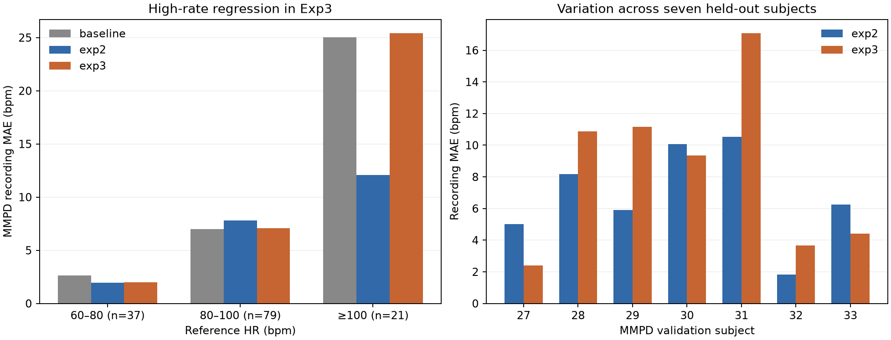

# Exp3 MMPD audit: high-rate HR regression despite better mean waveform measures

Reviewed 2026-11-27. The requested Exp3 source audit is complete. **Exp3 also loses to Exp2 on source recording-level HR**, with MMPD MAE 8.5147 versus 6.8709 bpm. Its earlier PURE regression therefore cannot be explained solely by cross-dataset transfer. Exp2 remains the leading tested model for aggregate recording-level HR; Exp3 has stronger average source waveform correlation/SNR, so these outcomes must be distinguished.

## Matched provenance and coverage

Supplied workspace folder: `Exp_data/exp3/mmpd_exp3_tcn_full/`. Manifest identifies `RegionalSTAttention` family with backend `tcn`, shared 3D stem, six TCN blocks, hidden48/spatial12/grid3, learned fusion, selected epoch38 and checkpoint:

```text
runs/RegionalSTAttention_20261126_230422/checkpoints/MMPD_PURE_RegionalSTTCN_best.pth
```

Reported checkpoint SHA256 is `34bdd3c3b00ebe8b30c7cf78d2e8e9f73d33463ffe44b29c9052dac2781e0b62`. This is supplied manifest provenance, not a rehash of a locally available checkpoint binary.

Training/audited file-list hashes, subject membership and protocol match original/Exp1/Exp2. Coverage and reference-check CSVs are byte-identical. All reference quantities and fixed GREEN/POS/CHROM controls match on recording/segment/window/method keys. All137 Exp3 saved reference, global RGB and regional RGB arrays exactly match Exp2. Every recording has eleven contiguous160-frame clips,1760 frames; total241120 frames, seven validation subjects27–33, zero omitted tails and zero unusable model windows. This is a full audit, not a limited smoke run.

The reconstruction check reproduces primary learned HRs and regional candidate decisions from all saved arrays. Exported candidates are individually centered per clip by `audit_regional_dino.fusion_controls`; weighted reconstruction therefore also removes per-clip DC before comparison with the model output. This is existing export behavior, not a waveform/evaluator modification.

MMPD validation already selected these checkpoints. These are source-validation diagnostics, not an independent source-test benchmark. Recording counts do not constitute137 independent subjects.

## Recording-level comparison

| Measure | Original no-DINO | Exp1 slowing | Exp2 attention | Exp3 TCN |
|---|---:|---:|---:|---:|
| MMPD MAE, bpm | 8.5660 | 11.4239 | **6.8709** | 8.5147 |
| MMPD RMSE, bpm | 13.5393 | 17.0337 | **12.1262** | 13.4439 |
| MMPD HR Pearson | .4981 | .3306 | **.6270** | .5010 |
| Within 5 bpm | 83/137 | 68/137 | **90/137** | 75/137 |
| Within 10 bpm | 94/137 | 80/137 | **102/137** | 94/137 |
| Errors over20 bpm | 22 | 32 | **17** | 22 |
| Signed HR bias, bpm | -7.1390 | -10.7380 | **-3.6069** | -7.1429 |
| PURE MAE, bpm (previous review) | 18.2611 | 13.5837 | **9.4464** | 16.7051 |

Exp3 source MAE is23.9% higher than Exp2 and close to the original baseline. Its lower within5 count and higher median error4.3204 versus1.6202 also matter: similar aggregate MAE to baseline does not mean identical error distribution. Against Exp2,46 recording errors improve,74 worsen and17 tie; three subject means improve and four worsen. No uncertainty/significance claim follows from these correlated recordings and one training run per architecture.

## High-rate discrimination is the central regression

| Reference HR | n | Exp2 MAE | Exp3 MAE | Correct dominant candidate, Exp2 / Exp3 |
|---|---:|---:|---:|---:|
| 60–80 bpm | 37 | 1.9413 | 1.9997 | 36 / 35 |
| 80–100 bpm | 79 | 7.8000 | **7.0686** | 65 / 62 |
| At least100 bpm | 21 | **12.0612** | 25.4340 | 12 / 3 |

The high-rate increase more than accounts for the net aggregate regression; the middle group offsets some error. Exp3's estimated recording HR range is64.81–102.07 bpm versus Exp2's54.01–119.89, with the high-rate Exp3 signed bias -25.3825 bpm. This resembles the original model's high-rate underestimation. It does not establish a memorized HR prior, motion mechanism or dataset artifact. Source recordings contain no reference below60, so this audit cannot resolve PURE's low-rate failures.

Source waveform correlation by rate also matters: Exp3 improves low/middle group means (.5397→.6298 and .3333→.3698) but worsens the high group (.2819→.2316). A better overall waveform average hides this difficult group's deterioration.

Subject MAE improves for27,30,33 and worsens for28,29,31,32. Largest regressions include subject29 5.9136→11.1521 and subject31 10.5311→17.0927. Subject27 improves5.0225→2.4032. HR and identity/conditions are confounded; these are descriptive results, not causal subject or skin-tone findings.



## Regional candidates and fusion

| Diagnostic | Exp2 | Exp3 |
|---|---:|---:|
| Learned fusion MAE | 6.8709 | 8.5147 |
| Uniform fusion of same candidates | 7.7579 | 8.6803 |
| Reference-selected regional oracle MAE | 3.2522 | 5.3296 |
| Any processed dominant candidate within5 bpm | 113/137 | 100/137 |
| Errors over10 with correct candidate available | 16 | 12 |
| Errors over10 without correct candidate | 19 | 31 |

Relative to Exp2,20 recordings lose a correct processed dominant candidate and seven gain one. Exp3 learned fusion gains only .1656 bpm over uniform, versus .8870 in Exp2. Both candidate availability and the regional oracle worsen, supporting a substantial candidate frequency-discrimination problem. A fusion intervention alone has limited evidence as the first fix.

Of37 recordings missing a correct processed dominant candidate,26 have a reference-near peak among a region's top3 peaks. These GT-assisted matches and the oracle are diagnostics only, not deployable recovery rules or proof of a clean physiological pulse. Absence of a processed dominant match does not prove raw pulse absence.

Neither model has a fused near-double or near-half source estimate. Regional second/fundamental power ratios exceed1 in17/1233 Exp3 outputs versus129/1233 Exp2 outputs. The main source failure is high-rate underestimation, not a generic doubling problem; fewer second harmonics do not by themselves establish better pulse estimates.

## Waveform measures and clip diagnostics answer different questions

| Mean source waveform diagnostic | Exp2 | Exp3 |
|---|---:|---:|
| Signed processed waveform correlation | .3812 | **.4188** |
| Fundamental SNR, dB | -5.8020 | **-3.6472** |
| Fundamental+second harmonic SNR, dB | -4.2314 | **-2.9050** |

Exp3 has stronger average source waveform measures despite worse dominant-HR error. Waveform correlation, reference-band energy and spectral argmax HR weight errors differently; none substitutes for the others. These averages do not establish calibrated amplitude, morphology or target waveform fidelity. Previous PURE absolute unshifted correlation remains weak in both variants.

Earlier source validation CLIP loss/r/HR also favored Exp3:1.2416/.3463/11.6876 versus1.3686/.2756/16.8535. The clip HR helper uses a Hann-windowed short-clip FFT; the audit uses whole-record reconstruction, smoothness-prior detrending/bandpass and Welch. Thus it is not a protocol-matched HR score. The new audit establishes that the clip advantage does not carry through to the primary source recording HR. It does not identify clip-boundary effects as the cause without an additional controlled diagnostic. Loss/selection alignment with intended recording HR remains a hypothesis to investigate on source data, not permission to select using PURE.

## Prediction processing sensitivity

Same reference HR and45–150bpm search, changing prediction preprocessing only:

| Exp3 prediction processing | MAE | Within5 | Within10 | Correct regional candidate |
|---|---:|---:|---:|---:|
| Raw, DC removed | 8.6251 | 79 | 93 | 100 |
| Detrended, no bandpass | 8.4714 | 80 | 95 | 103 |
| Current filtered primary | 8.5147 | 75 | 94 | 100 |

Removing the bandpass provides little aggregate source recovery for Exp3. Retain the common primary evaluator; these diagnostics are not alternative benchmark claims. Exp2 source filtering helps considerably (raw11.1637/detrended9.4845/filtered6.8709), while on PURE it hurts. There is no supported universal filter replacement from these observations.

## Decision after this audit

This requested source audit is complete; no repeat is pending. Retain Exp2 attention as the working **HR reference**, preserve Exp3 as a completed control, and prioritize a reproducibility comparison before adding another architecture module. The recommended next training comparison is unchanged Exp2 and Exp3 with a second explicit matched seed; if only one new run is feasible, prioritize repeating Exp2. Several matched seeds are needed before an attention-versus-TCN paper claim. Keep source split, update budget, checkpoint rule, loss and primary evaluation fixed, and report rate/subject breakdowns and waveform measures alongside aggregate HR.

Current `main.py` hardcodes `RANDOM_SEED=100`; rerunning the unchanged command does not create a new-seed experiment. A future seed-repeat launch needs an explicit reproducible seed option applied before model/data-loader initialization and recorded with the run. This review does not alter training behavior or provide a misleading new-seed command.

The prepared2D long-TCN control is useful for separating stem/context attribution, but is lower priority than confirming the large Exp2 HR advantage. A subsequent model contribution should address an identified pulse-specific failure, such as maintaining correct fundamental frequency under nuisance while retaining waveform fidelity, with a narrow mechanism and controls. Combining3D/attention/Mamba/deformable operators alone is not novelty. Fresh untouched confirmation data remains necessary because PURE has guided development.

## Reproduction

[Analysis script](../../tools/review_mmpd_exp3_results.py), [summary/provenance](results/exp3_mmpd_20261127/summary.json), [matched recordings](results/exp3_mmpd_20261127/matched_recordings.csv), [rate groups](results/exp3_mmpd_20261127/hr_bins.csv), [subjects](results/exp3_mmpd_20261127/subject_metrics.csv), [processing sensitivity](results/exp3_mmpd_20261127/processing_stages.csv). Run `python tools/review_mmpd_exp3_results.py` from the repository with supplied artifact folders present. Only analysis artifacts and research notes changed; no model, training settings, labels or evaluator changes were made.
