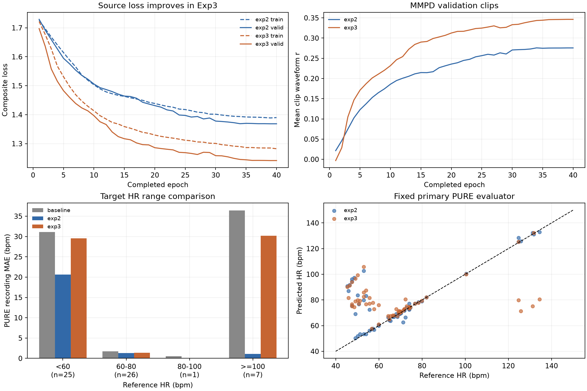

# Exp3 matched TCN control: source clip gains, PURE regression

Reviewed 2026-11-27. Exp3's primary full-PURE MAE is **16.7051 bpm**, versus **9.4464** for Exp2 and **18.2611** for the original no-DINO model. This is a substantial regression relative to Exp2, although still slightly better than the original model. Retain Exp2 as the leading tested architecture.

## Run and comparison validity

Supplied artifacts: workspace `Exp_data/exp3/{training.log,regional_history.jsonl,regional_waveforms.pt}`. All 40 epochs completed. Source-validation loss selected and the log reports loading zero-based epoch **38** from:

```text
runs/RegionalSTAttention_20261126_230422/checkpoints/MMPD_PURE_RegionalSTTCN_best.pth
```

Both resolved settings and saved tensor metadata identify family `RegionalSTAttention`, backend **tcn**, spatial size 12, hidden dimension 48, nine grid regions and learned fusion. The family name alone is not evidence of an attention run. Source code constructs six TCN blocks for this backend, retaining the same new 3D regional stem. Exp2 uses two local TCN blocks and three temporal-attention blocks. Trainable parameters are 100,936 and 101,368 respectively, a difference of about 0.43%.

Resolved configs differ only in inheritance bookkeeping, run/checkpoint names and paths, and the temporal backend. Data, loss, schedule, checkpoint rule and augmentation settings match: MMPD train subjects 1–26, validation 27–33; Raw RGB, standardized labels, 160 frames at 30 Hz, batch 16, 40 epochs, OneCycle peak LR 1e-4, no rate augmentation. There are 5,709/1,507/750 train/validation/PURE clips. All 750 saved reference clips match Exp2 exactly. Reconstructed weighted regional waveforms reproduce the logged prediction HRs and official MAE for all 59 recordings / 120,000 frames.

Artifact fingerprints and config differences are recorded in [summary.json](results/exp3_20261127/summary.json). No checkpoint binary or server cache fingerprints were supplied for this run.

## Primary target results

| Measure | Original no-DINO | Exp1 slowing | Exp2 attention | Exp3 TCN |
|---|---:|---:|---:|---:|
| PURE MAE, bpm | 18.2611 | 13.5837 | **9.4464** | 16.7051 |
| RMSE, bpm | 26.1051 | 22.8694 | **18.5096** | 25.1422 |
| HR Pearson r | .0843 | .2679 | **.7227** | .2544 |
| Within 5 bpm | 27/59 | 35/59 | **43/59** | 31/59 |
| Errors over 10 bpm | 31 | 22 | **14** | 27 |
| Errors over 20 bpm | 25 | 18 | **12** | 25 |

Exp3 MAE is 7.259 bpm (76.8%) higher than Exp2. Paired recording errors worsen in 35, improve in 18 and tie in six. These are correlated recordings from ten subjects and one training run per design, not independent replicated model comparisons.

| Reference HR | n | Exp2 MAE | Exp3 MAE |
|---|---:|---:|---:|
| Below 60 bpm | 25 | 20.6085 | 29.5302 |
| 60–80 bpm | 26 | 1.3294 | 1.3917 |
| 80–100 bpm | 1 | 0 | 0 |
| At least 100 bpm | 7 | 1.0801 | 30.1659 |

The middle range remains accurate; low- and high-rate cases drive the regression. Subject07 MAE rises 1.2601→35.1035, subject03 3.3303→22.8623 and subject08 8.5509→34.7435. The seven high-rate recordings involve only two people, six from subject07. Rate and identity/conditions remain confounded; a learned middle-rate shortcut is a hypothesis, not an established mechanism.

## Training learned, but source and target measures diverge

At their source-selected checkpoints:

| MMPD validation **clip** measure | Exp2 | Exp3 |
|---|---:|---:|
| Composite loss | 1.36857 | **1.24156** |
| Waveform correlation | .27564 | **.34632** |
| Spectral loss | .22364 | **.18161** |
| Clip HR MAE, bpm | 16.8535 | **11.6876** |
| Raw MSE | **.93696** | .95096 |
| Prediction standard deviation | .26374 | .42515 |

Source training and validation loss decrease smoothly and largely plateau late in training. There is no evident optimization collapse or late validation-loss divergence. Exp3 does not fail simply because it cannot fit source data. The slightly worse raw MSE also shows why improved composite loss must not be read as improvement in every waveform measure.

These clip HR scores have different windows and estimators from the full-record audits. Exp2's full-record MMPD validation MAE is 6.8709. **Exp3's comparable source-record result is missing**. Until it arrives, domain shift and clip-versus-record reconstruction effects remain competing explanations.



## Regional extraction and fusion

| Saved-PURE diagnostic | Exp2 | Exp3 |
|---|---:|---:|
| Learned fusion MAE | 9.4464 | 16.7051 |
| Uniform fusion, same candidates | 10.0871 | 16.7142 |
| Reference-selected regional oracle MAE | 2.5813 | 12.4121 |
| Any processed dominant regional HR within 5 bpm | 49/59 | 33/59 |
| Fused errors >10 bpm with a correct regional candidate | 5 | 2 |
| Fused errors >10 bpm without a correct regional candidate | 9 | 25 |

Sixteen recordings lose a correct processed dominant regional candidate relative to Exp2, with none gained. Learned-versus-uniform fusion barely changes Exp3's aggregate error. Together with the much worse regional oracle, this points mainly to poorer regional frequency extraction/discrimination on PURE, rather than only incorrect weighting. Uniform fusion is a post-hoc operation on jointly learned waveforms; it is not a separately trained control.

Candidate availability is processing-dependent and does not prove pulse information is absent. The oracle uses GT to choose the best region and is **diagnostic only**. Six fused estimates are near twice reference HR. A strong second harmonic is not automatically an artifact or a rule for halving inference estimates.

Processed mean signed waveform r is .0460 versus Exp2's .00355, but mean absolute unshifted r is essentially unchanged (.1421 versus .1416). Neither run demonstrates strong target waveform fidelity from these measures. HR Pearson in the primary table is a different statistic across recording-level HR pairs.

## Filtering contributes, but does not explain the gap

The same fixed reference HR and 45–150 bpm search are retained, changing only prediction preprocessing:

| Prediction processing | Exp2 MAE | Exp3 MAE | Exp2 / Exp3 correct regional candidate |
|---|---:|---:|---:|
| Raw, DC removed | 4.4760 | 12.7142 | 57 / 40 |
| Detrended, no bandpass | 4.6591 | 12.9979 | 56 / 39 |
| Current filtered primary pipeline | 9.4464 | 16.7051 | 49 / 33 |

Exp3 remains substantially worse before filtering. Keep the current primary score; these are sensitivity diagnostics, not replacement benchmark results. Previous source results showed that filtering helps MMPD overall, so removing it based on PURE would be test-driven protocol tuning.

## Next action

Keep Exp2 as the working reference. Obtain **one full-record source-validation audit of the existing Exp3 checkpoint**, with the same protocol used for Exp2. This requires inference on the server, not another training run:

```bash
python tools/audit_regional_dino.py \
  --config configs/train_configs/ablations/regional_st_tcn.yaml \
  --checkpoint runs/RegionalSTAttention_20261126_230422/checkpoints/MMPD_PURE_RegionalSTTCN_best.pth \
  --split valid \
  --save-waveforms \
  --output diagnostics/mmpd_exp3_tcn_full
```

Run from the server `rPPG_VLM` root. If full-record source HR is competitive while PURE remains worse, the evidence for a transfer trade-off strengthens. If source-record performance also worsens despite better clip measures, inspect reconstruction, clip boundaries and spectral dominance before attributing the loss to domain shift alone. Preserve split membership and classical/reference checks against previous audits.

This control supports retaining Exp2's particular temporal design under the tested settings. It does not isolate an attention mechanism from all context/optimization differences, prove universal attention superiority, or establish novelty. A nominal 253-frame TCN span does not create extra real observations in a 160-frame clip. Use repeated matched seeds and fresh confirmatory data before contribution claims; PURE has already influenced development.

## Reproduction and local changes

[Analysis script](../../tools/review_exp3_results.py), [summary](results/exp3_20261127/summary.json), [paired recordings](results/exp3_20261127/exp2_exp3_pairs.csv), [regional candidates](results/exp3_20261127/regional_candidates.csv), [subjects](results/exp3_20261127/subject_metrics.csv), [history](results/exp3_20261127/training_history.csv), [processing sensitivity](results/exp3_20261127/processing_stages.csv). Run `python tools/review_exp3_results.py` from the repository with the supplied workspace folders present. Only analysis artifacts and research notes were added/updated; no model, training configuration, loss, labels or evaluator changed.
