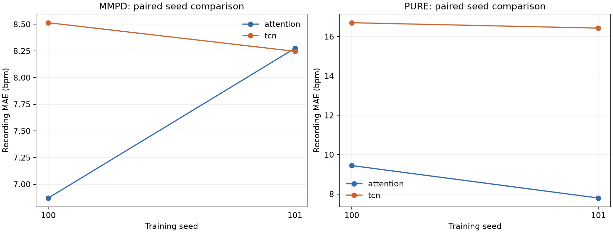

# Seed101 paired repeat: PURE advantage reproduced, MMPD aggregate tied

Reviewed 2026-11-27. Both requested seed101 training runs and full MMPD validation audits are complete. **Attention's exploratory PURE HR advantage reproduced strongly**, while its earlier aggregate MMPD HR advantage did not: seed101 MMPD recording MAE is effectively tied. Retain attention as the working cross-dataset HR backbone, report both seeds, and distinguish this choice from a universal attention or waveform-recovery claim.

## Verified runs and comparison

Supplied workspace folders:

- `Exp_data/expt4_st_attention_tcn/st_attention/`, including `mmpd_attention_seed101_full/`.
- `Exp_data/expt4_st_attention_tcn/st_tcn/`, including `mmpd_tcn_seed101_full/`.

Both complete40epochs with seed101 in resolved config, all history rows, loaded-checkpoint log, saved PURE tensor metadata and source audit manifest. Selected zero-based epochs are35 attention and39 TCN. The log reports loading the source-loss-selected best checkpoint in each case. Training settings differ from the corresponding seed100 run only by the explicit seed and run paths; model/data/loss/schedule/augmentation settings match. Attention101 and TCN101 retain the intended temporal backends and constructor arguments. The model-family name remains `RegionalSTAttention` for both variants.

| Run | Source-selected epoch | Server run directory | Checkpoint hash reported by audit |
|---|---:|---|---|
| Attention101 |35|`runs/RegionalSTAttention_20261127_093522`|`6ad3bd31432a8d5d4eb31cb45bc5ceecdffbb217658a2d47d95a3cdb13bd2843`|
| TCN101 |39|`runs/RegionalSTAttention_20261127_093716`|`caeb2471e19cf07074970f5d106f00d3aa26fe8c6bcb11f1181e12d6f54d3740`|

These hashes are manifest provenance, not local binary rehashes; no trained checkpoint binaries were supplied. Earlier seed100 provenance follows the historical fixed entry point rather than embedded seed metadata.

For PURE, all750 reference clips in each new run exactly match Exp2. Reconstructed raw clips and weighted regional outputs reproduce all59 logged reference/prediction HR pairs and official MAEs. For MMPD, all137 new reference/globalRGB/regionalRGB arrays exactly match the original attention audit. Source train/audit file-list hashes, subjects, protocol, coverage/reference-check bytes, all reference quantities and fixed classical controls match across the four runs. Both new audits cover241120frames from subjects27–33, with no omitted tails. Reconstructed learned/regional HRs agree with supplied audit tables.

No model, trainer, loss, labels, config or evaluator changed during this review. Reproducible analysis is in [review_seed101_results.py](../../tools/review_seed101_results.py); artifact fingerprints and matching checks are in [summary.json](results/seed101_20261127/summary.json).

## Primary recording HR results

| Dataset / seed | Attention MAE | TCN MAE | Attention minus TCN |
|---|---:|---:|---:|
| MMPD100 |6.8709|8.5147|-1.6438|
| MMPD101 |8.2743|8.2467|+0.0276|
| PURE100 |9.4464|16.7051|-7.2587|
| PURE101 |7.7987|16.4305|-8.6317|

The .0276bpm source difference at101 is practically a tie. It reverses the numerical ranking, so the claim that attention improves aggregate source HR consistently is unsupported. Attention101 also has25 source errors over20bpm versus TCN101's20, despite slightly more within5 recordings85vs83. These different error distributions matter beyond the mean.

The repeated PURE advantage is substantial: at101 attention has46/59 within5bpm versus TCN30/59; RMSE16.6827 versus24.4676, HR Pearson .7446 versus .2855. Paired recording errors favor attention38times, TCN13times, with eight ties. At100 those counts were35/18/6. The same recordings are reused across seeds, so these counts are not independent subject-level replications.

Descriptive arithmetic means of the **two run MAEs**, not ensemble scores or confidence intervals:

| Dataset | Attention mean [range] | TCN mean [range] |
|---|---:|---:|
| MMPD |7.5726 [6.8709–8.2743]|8.3807 [8.2467–8.5147]|
| PURE |8.6226 [7.7987–9.4464]|16.5678 [16.4305–16.7051]|

Two seeds are insufficient for a reliable variance estimate or universal mechanism claim. Do not choose attention101 merely because it has the best PURE score: attention100 has better source recording MAE, and both must be reported. MMPD validation selected checkpoints and is not an independent source test. PURE has already guided development and remains exploratory.

## Rate groups reveal the repeated pattern

| Dataset / reference HR | n | Attention100 | TCN100 | Attention101 | TCN101 |
|---|---:|---:|---:|---:|---:|
| MMPD60–80 |37|1.9413|1.9997|2.7441|2.3062|
| MMPD80–100 |79|7.8000|7.0686|8.9690|6.6857|
| MMPD≥100 |21|12.0612|25.4340|15.4044|24.5853|
| PURE<60 |25|20.6085|29.5302|15.8128|28.6445|
| PURE60–80 |26|1.3294|1.3917|.7062|1.5994|
| PURE80–100 |1|0|0|.5401|0|
| PURE≥100 |7|1.0801|30.1659|6.5578|30.2430|

Attention's high-rate MMPD advantage repeats, but worse low/middle source groups erase the aggregate benefit at101. Correct dominant high-rate source candidates occur in11/21 attention101 recordings versus5/21 TCN101 (100:12vs3). On PURE both low/high groups favor attention, though its high-rate error is less impressive at101 than100. Six of seven high-rate PURE recordings are from subject07, and the seventh from subject10; this is not independent evidence across seven high-rate people.

At101 source subject MAE favors attention for29/30/31 and TCN for27/28/32/33. Attention's subject28 MAE rises8.1818→14.6625 between seeds, while subject31 rises10.5311→12.0162. On PURE, attention101 still has subject05/09 MAEs29.2529/32.0432 despite strong results for most other subjects. Rate, subject and conditions remain confounded; these observations do not establish an identity or skin-tone mechanism.

## Candidate extraction improves more reliably than fused source MAE

| Seed101 diagnostic | Attention MMPD | TCN MMPD | Attention PURE | TCN PURE |
|---|---:|---:|---:|---:|
| Learned fusion MAE |8.2743|8.2467|7.7987|16.4305|
| Uniform, same candidates |8.5502|8.6409|8.6409|16.4305|
| GT-selected regional oracle MAE |2.8737|4.8408|2.8833|11.7164|
| Any processed dominant candidate within5 |114/137|104/137|51/59|35/59|
| Fused errors>10 with correct candidate |22|16|6|5|
| Fused errors>10 without correct candidate |20|28|7|23|

Attention's greater candidate availability and lower diagnostic regional oracle repeat on both populations. On PURE at101,16 recordings have an attention candidate but no TCN candidate; none show the reverse, matching the earlier seed's pattern. On MMPD the counts are15vs5.

Attention101 retains slightly more source candidates than attention100 (114vs113), and the regional oracle improves3.2522→2.8737, while fused source MAE worsens6.8709→8.2743. Thus source regression is not simply a global loss of candidate availability. Source fused errors with an available correct candidate rise16→22, while those without rise19→20. Region/candidate selection, relative amplitudes, phase/cancellation and time-varying mixing are possible mechanisms; these data do not isolate one. A GT oracle is not an achievable performance promise, and scalar fusion may be unable to reproduce per-record oracle selection.

The current no-DINO gate's inputs are RGB/difference moments rather than the predicted regional waveforms or their spectra (`RegionalDINO.forward`). Its quality target ranks detached regional correlation+JS-spectrum errors, with a mean-logit region supervision term, while the actual inference weights vary over time (`RegionalPulseLoss.forward`). This gives a concrete, testable design question about pulse-aware weighting, not proof of a gate defect. Extraction remains relevant because20source and7target large attention101 errors still lack a correct **processed dominant** regional candidate.

Missing processed candidates do not prove absence of raw pulse information. GT-selected regions, secondary peaks, lag/polarity and preprocessing stages are diagnostic only.

## Waveform fidelity and filtering remain limitations

TCN again has stronger average source waveform diagnostics: mean signed processed r .4174 versus attention .3929, fundamental SNR -3.4898 versus -5.7659dB. Its source clip loss/HR diagnostics also remain better: loss1.2470 vs1.3523 and clipMAE11.1874 vs16.3766. Those short-clip FFT measures differ from the primary full-record Welch protocol and do not rank transfer HR reliably.

On PURE, attention's better HR does not establish recovered waveform morphology or phase. Mean absolute unshifted processed correlation is only .1339, versus TCN .1437; signed means are .0662/.0656. Keep waveform and recording-HR claims separate.

Prediction preprocessing sensitivity, retaining the fixed reference HR and45–150bpm search:

| Seed101 prediction processing | Attention MMPD | TCN MMPD | Attention PURE | TCN PURE |
|---|---:|---:|---:|---:|
| Raw, DC removed |13.0993|8.7000|2.7552|12.0276|
| Detrended, no bandpass |11.6723|8.4792|3.0481|12.8240|
| Current filtered primary |8.2743|8.2467|7.7987|16.4305|

The opposing filter effect repeats: it helps attention on MMPD and hurts it on PURE. Raw PURE2.7552 is a sensitivity diagnostic, not a replacement benchmark result or justification to change the evaluator based on inspected target data. Attention's PURE advantage remains before filtering too, so it is not solely a filter artifact.

## How to proceed

The seed101 repeat and both source audits are completed; no additional server audit is needed to interpret them. Use the attention architecture as the fixed working baseline for targeted development. A third seed pair102 remains useful for confirmation and can follow or run alongside design work, but another generic seed repeat need not block the next hypothesis.

The next design priority is one **pulse-aware regional fusion/discrimination intervention** on the fixed attention extractor, selected and developed using source training/validation criteria. Start by comparing the same regional outputs under current learned fusion, uniform and a simple waveform-aware control; inspect competing-frequency and phase/amplitude cancellation on source failures with available candidates. Freeze extractor/regional heads and compare an equally retrained RGB/difference-moment gate with a gate additionally observing candidate waveform information, matching source data, objective and update budget; otherwise extra optimization would confound the mechanism. Any frozen-extractor comparison must hold candidates fixed and use GT only for training supervision/labelled diagnosis, not inference selection. A waveform-aware gate should first be tested against simpler controls before adding phase/frequency machinery. This remains a research hypothesis, not an implemented experiment or novelty claim.

This direction addresses an observed extraction-to-fusion gap and preserves the repeated target HR advantage as a baseline. It cannot fix all missing-candidate failures. Before specifying a new spectral objective, account for the existing correlation and JS-spectrum supervision; simply increasing a spectral weight or adding Mamba/DINO/deformable modules is not justified. The closest regional/spectral/phase-aware fusion prior art in the research notes must inform any contribution claim. Keep loss, schedule, split and primary evaluator fixed for the first isolated comparison wherever the hypothesis permits. Fresh untouched data and further matched seeds are required for confirmatory generalization claims.

## Reproduction

[Numeric summary and hashes](results/seed101_20261127/summary.json), [all metrics](results/seed101_20261127/metrics.csv), [rate/subject groups](results/seed101_20261127/groups.csv), [PURE paired101](results/seed101_20261127/pure_paired_seed101.csv), [MMPD paired101](results/seed101_20261127/mmpd_paired_seed101.csv), [new PURE regional diagnostics](results/seed101_20261127/pure_new_regional.csv), [processing sensitivity](results/seed101_20261127/processing_stages.csv), [training histories](results/seed101_20261127/training_history.csv). Run `python tools/review_seed101_results.py` from the repository with supplied workspace folders and earlier derived seed100 tables present. Signal checks passed for both new exports and every source recording; the figure was visually checked. This results-only review does not require new model tests.
